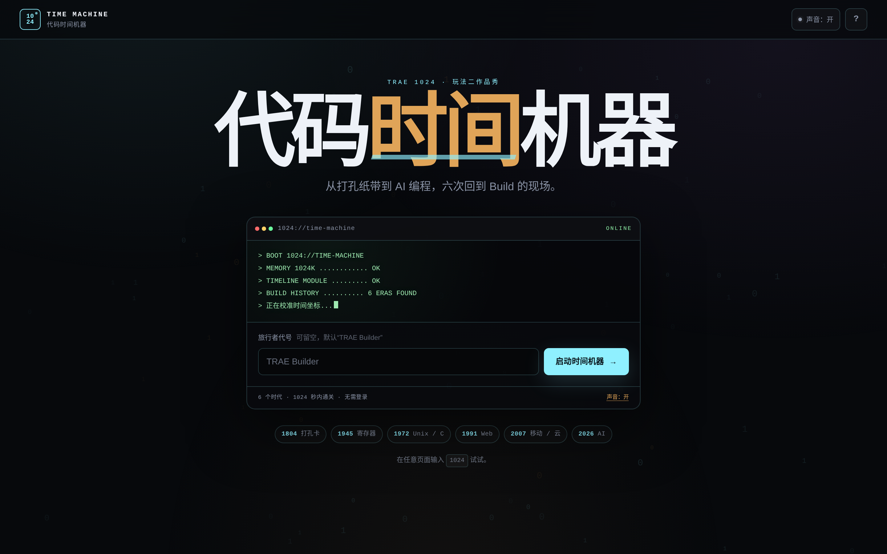
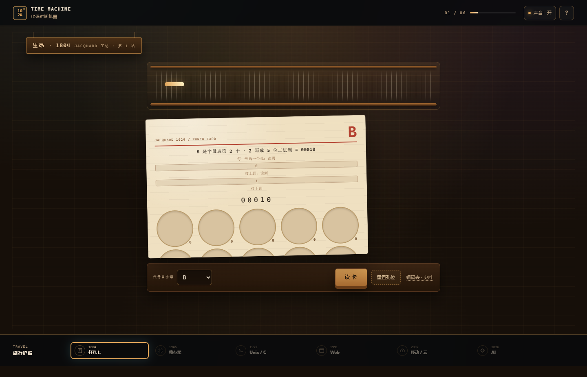
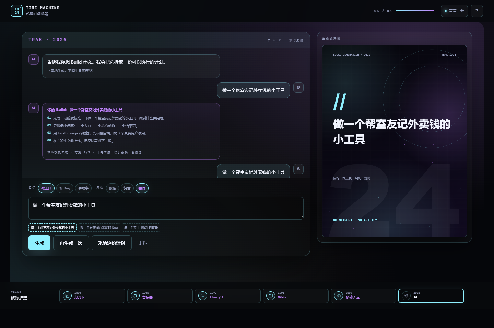
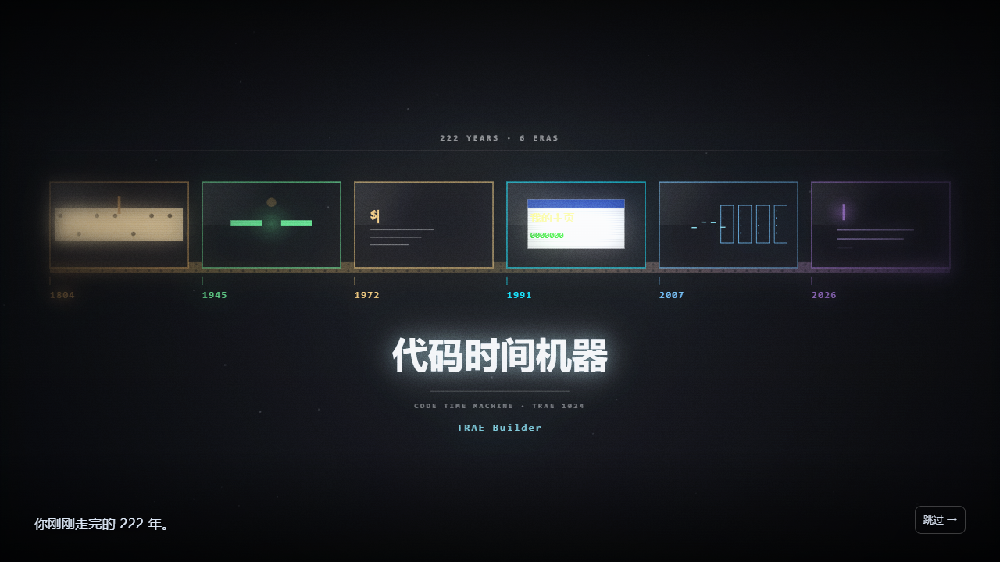
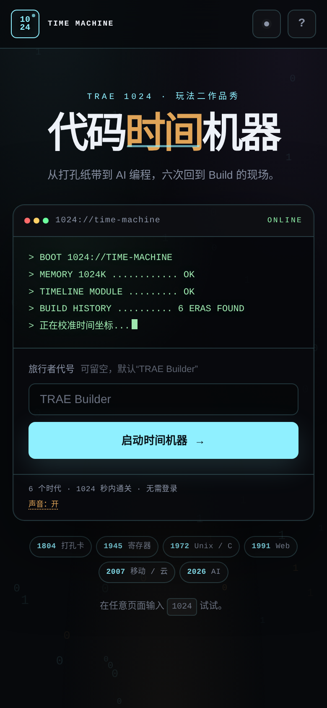
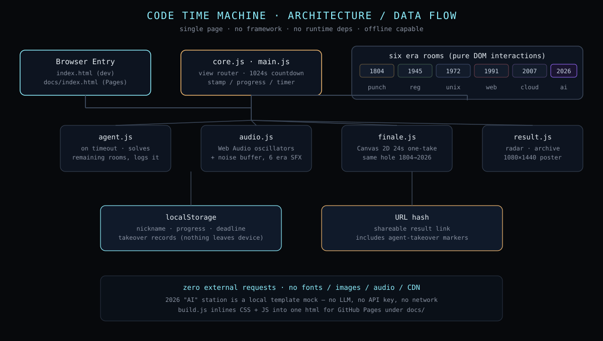

# 代码时间机器 · The Code Time Machine


> 从打孔纸带到 AI 编程，六次回到 Build 的现场。 / From punch cards to AI pair programming: six stops back at the Build bench.

**Live Demo:** https://reserendipity.github.io/Code-Time-Machine-1024/

TRAE 社区 1024 狂欢周 · 玩法二「TRAE 1024 作品秀」参赛作品。

[中文](#中文) | [English](#english)

---

## 中文

### 这是什么

一台藏在 **1024 号机房**的旧终端，带你回到六个编程时代，每一站留下一枚印章，最后生成你的 Builder 类型、四维雷达和一张 1080×1440 的可下载海报。

**限时 1024 秒**，从按下“启动时间机器”开始。时间用完，机器替你继续——进入 **Agent 接管**：AI 逐关把剩下的站接完，档案如实写明哪几站是它替你 Build 的，并把接管计入“指挥”维度；随时可以点“我来”拿回控制权。

### 核心特性

- **六个时代、六间房间**：1804 打孔卡 / 1945 寄存器 / 1972 Unix·C / 1991 Web / 2007 移动·云 / 2026 AI，每关一个独立小谜题，不是同一套模板换色。
- **1024 秒倒计时 + Agent 接管**：超时自动续玩，接管过程与结果在档案里透明标注，可随时夺回。
- **程序化结尾动画**：24 秒一镜到底，同一个“孔”从纸带到光标贯穿 222 年，Canvas 全程序化绘制，含运镜、颗粒、暗角。
- **零依赖、可离线**：原生 HTML/CSS/JavaScript，无框架、无构建步骤、无外部字体/图片/音频；Web Audio 实时合成六套时代音色。
- **隐私本地优先**：昵称、进度、截止时间、接管记录全部存在 localStorage；海报在本地 Canvas 生成；2026 “AI”关是本地模板模拟，不调用任何大模型、不消耗 API Key。
- **可访问性**：支持 `prefers-reduced-motion`（结尾动画降级为静态胶片带），交互可用键盘完成，已验证 390 / 360 / 320px 手机宽度。

### 展示

**首页 · 旧终端启动，输入代号即可出发：**



**1804 · 里昂 Jacquard 工坊**——用 5 位二进制打出代号首字母：



**2026 · AI 时代**——这次提示词由你写，本地把它拆成一份 Build 计划，并实时生成右侧海报：



**结尾时间线 · 222 年、六枚印章、同一个孔：**



**移动端 · 390px 宽度下的首页与启动按钮：**



**架构与数据流 · 单页、零外部请求：**



### 快速开始

无需安装任何依赖，只要有 Python 3 或任意静态文件服务器：

```bash
# 1. 克隆
git clone https://github.com/ReSerendipity/Code-Time-Machine-1024.git
cd Code-Time-Machine-1024

# 2. 启动静态服务器（任选其一）
python3 -m http.server 8080

# 3. 打开浏览器游玩
#    http://localhost:8080/index.html
```

**最小验证**：打开首页看到“BOOT 1024://TIME-MACHINE”启动行与六枚时代徽章 → 输入代号点“启动时间机器” → 第一关打孔卡能正常交互，即代表环境就绪。

也可以直接双击 `docs/index.html` 离线游玩（GitHub Pages 发布的单文件版），或访问上方 Live Demo。

### 构建单文件版

```bash
node build.js
# 生成 code-time-machine.html（CSS/JS 全部内联）
# GitHub Pages 使用的单文件位于 docs/index.html
```

### 系统要求与兼容性

- 现代浏览器（Chrome / Edge / Firefox / Safari 最近两个大版本），需要支持 Canvas 2D 与 Web Audio API。
- 桌面 1280px 以上、手机 320px 以上宽度已验证；键盘与鼠标均可通关。
- 无网络、无账号、无 API Key 要求；本地模板生成的 2026 “AI”关不发起任何网络请求。

### 使用示例

- 任意一关答错两次后，提示面板会出现“让 Agent 接手这一关”。
- 时间耗尽进入 Agent 接管后，随时点“我来”拿回当前关的控制权。
- 在任意页面直接输入 `1024`，会触发一个隐藏频道。
- 通关后的结果页支持“复制分享链接”，链接里包含接管标注，发给朋友打开就能看到你的档案。

### FAQ

**Q：需要登录或联网吗？**
A：不需要。全程本地运行，昵称与进度只存在你自己的浏览器里。

**Q：2026 那一关是不是真的在调用大模型？**
A：不是。它是“把一句话拆成 Build 计划”的本地模板模拟，不消耗任何 API Key，也不会上传你的提示词。

**Q：1024 秒用完会直接结束吗？**
A：不会。超时后 Agent 会逐关替你完成剩余站点，档案会如实标注哪些站是它替你 Build 的；你也可以随时接管。

**Q：声音可以关吗？**
A：可以。右上角“声音”按钮随时静音，偏好会被记住。

**Q：手机上能玩吗？**
A：能。已在 390 / 360 / 320px 宽度下验证，触屏与鼠标都支持。

### 文档与治理

- 仓库结构见下文“目录”一节；发布到 GitHub Pages 的是 `docs/index.html`（由 `build.js` 生成的单文件版）。
- Agent 行为契约见 [`docs/agent-contract.md`](docs/agent-contract.md)。
- 史料参考列在文末，仅用于交代时代背景，交互为示意性玩法。

### 贡献、安全与支持

- 欢迎 Issue 与 PR；提交前请本地 `python3 -m http.server` 自测一遍六关流程。
- 发现安全问题请通过 Issue 或仓库维护者披露，不要公开挂出利用细节。
- 问题反馈请附上浏览器、操作系统与复现步骤；本项目不收集任何遥测，无法从服务端排查。

### 许可证

代码与原创美术采用 **Apache License 2.0**，详见 [LICENSE](LICENSE) 与 [NOTICE](NOTICE)。

### 目录

```
index.html            # 开发版入口
styles.css            # 全局样式与六间房间
js/                   # 状态、音效、六个时代、Agent 接管、结尾动画、结果页、主流程
docs/index.html       # GitHub Pages 发布的单文件版
docs/.nojekyll        # 关闭 Jekyll
docs/assets/          # 本 README 引用的截图与架构图
screenshots/          # 开发过程中的全部截图与海报
build.js              # 单文件构建脚本
```

### 史料参考

- Jacquard loom · https://en.wikipedia.org/wiki/Jacquard_loom
- Herman Hollerith · https://en.wikipedia.org/wiki/Herman_Hollerith
- ENIAC · https://en.wikipedia.org/wiki/ENIAC
- Grace Hopper · https://en.wikipedia.org/wiki/Grace_Hopper
- C language · https://en.wikipedia.org/wiki/C_(programming_language)
- Unix · https://en.wikipedia.org/wiki/Unix
- The Art of Unix Programming · http://www.catb.org/esr/writings/taoup/html/
- World Wide Web · https://home.cern/science/computing/birth-web
- First website · http://info.cern.ch/hypertext/WWW/TheProject.html
- iPhone (1st generation) · https://en.wikipedia.org/wiki/IPhone_(1st_generation)
- GitHub Copilot · https://en.wikipedia.org/wiki/GitHub_Copilot
- ChatGPT · https://en.wikipedia.org/wiki/ChatGPT

---

## English

### What it is

An old terminal hidden in **Room 1024** that sends you back through six eras of software building. Each era leaves a stamp; at the end you get your Builder type, a four-dimension radar chart, and a downloadable 1080×1440 poster.

You have **1024 seconds** from the moment you press *Start*. When time runs out, the machine keeps going for you — **Agent takeover** kicks in: an agent finishes the remaining stations one by one, your archive honestly records which ones it built on your behalf, and that takeover is scored into the *Command* dimension. You can always press *I'll do it* to take control back.

### Highlights

- **Six eras, six rooms**: 1804 punch card / 1945 register / 1972 Unix·C / 1991 Web / 2007 mobile·cloud / 2026 AI — each room is its own small puzzle, not a reskinned template.
- **1024-second timer + Agent takeover**: timeouts don't end the run; the takeover and its outcome are flagged transparently in your archive, and you can retake control at any time.
- **Programmed closing sequence**: a 24-second one-take where the same "hole" travels from paper tape to a cursor across 222 years, drawn fully in Canvas 2D with camera moves, grain and vignette.
- **Zero dependencies, offline-first**: vanilla HTML/CSS/JavaScript, no framework, no build step, no external fonts/images/audio; six era soundscapes are synthesized live with Web Audio.
- **Privacy by design**: nickname, progress, deadline and takeover records live in `localStorage`; the poster is drawn on a local Canvas; the 2026 "AI" station is a local-template mock — no LLM, no API key.
- **Accessible**: honors `prefers-reduced-motion` (the finale degrades to a static film strip), keyboard-completable, verified at 390 / 360 / 320px widths.

### Showcase

**Landing · an old terminal boots up; type your callsign and go:**


**1804 · Jacquard workshop, Lyon** — punch your callsign's first letter in 5-bit binary:


**2026 · AI era** — you write the prompt this time; it is split locally into a Build plan, with a poster generated live on the right:


**Ending timeline · 222 years, six stamps, one and the same hole:**


**Mobile · landing and start button at 390px width:**


**Architecture & data flow · single page, zero external requests:**


### Quick start

No install, just Python 3 or any static file server:

```bash
# 1. Clone
git clone https://github.com/ReSerendipity/Code-Time-Machine-1024.git
cd Code-Time-Machine-1024

# 2. Serve locally
python3 -m http.server 8080

# 3. Open in a browser
#    http://localhost:8080/index.html
```

**Smoke check**: you should see the `BOOT 1024://TIME-MACHINE` boot lines and the six era chips on the landing page; entering a callsign and pressing *Start* takes you to the punch-card room where interactive punching works.

You can also open `docs/index.html` directly (the single-file build shipped for GitHub Pages), or use the Live Demo linked above.

### Build the single-file bundle

```bash
node build.js
# produces code-time-machine.html with inlined CSS/JS
# the GitHub Pages entry is docs/index.html
```

### Requirements & compatibility

- A recent browser (latest two major versions of Chrome / Edge / Firefox / Safari) with Canvas 2D and Web Audio API.
- Verified at desktop widths ≥1280px and mobile widths 320–390px; keyboard and mouse both complete the game.
- No network, account or API key required; the 2026 "AI" station makes no network calls.

### Usage notes

- Two wrong answers in a row surface a *Let the agent take this one* option in the hint panel.
- After time expires, press *I'll do it* at any moment to take back the current station.
- Typing `1024` on any page triggers a hidden channel.
- The result page has *Copy share link*; the link encodes your archive, including takeover flags.

### FAQ

**Q: Do I need to sign in or stay online?**
A: No. Everything runs locally; your nickname and progress stay in your own browser.

**Q: Is the 2026 station really calling an LLM?**
A: No. It is a local-template mock of "turn a sentence into a Build plan"; it uses no API key and never uploads your prompt.

**Q: Does the run end at 1024 seconds?**
A: No. On timeout an agent finishes the remaining stations, your archive marks which ones it built for you, and you can retake control at any point.

**Q: Can I mute the sound?**
A: Yes — the *Sound* toggle in the top-right mutes instantly and remembers your preference.

**Q: Does it work on phones?**
A: Yes. Verified at 390 / 360 / 320px widths with touch and mouse input.

### Docs & governance

- See the *Repository layout* section below; the GitHub Pages entry is `docs/index.html` (the single-file output of `build.js`).
- The agent behavior contract lives in [`docs/agent-contract.md`](docs/agent-contract.md).
- Historical references are listed at the bottom for context only; the interactions are illustrative puzzles.

### Contributing, security & support

- Issues and PRs welcome; before opening a PR, run the six-station flow locally with `python3 -m http.server`.
- For security issues, please disclose via a private channel or the repo maintainer rather than posting exploit details.
- When filing an issue, include browser, OS and reproduction steps; this project ships no telemetry, so we cannot debug from the server side.

### License

Code and original artwork are licensed under the **Apache License 2.0**. See [LICENSE](LICENSE) and [NOTICE](NOTICE).

### Repository layout

```
index.html            # development entry
styles.css            # global styles + six rooms
js/                   # state, audio, six eras, agent takeover, finale, result, main flow
docs/index.html       # GitHub Pages single-file build
docs/.nojekyll        # disable Jekyll
docs/assets/          # screenshots and diagram referenced by this README
screenshots/          # development screenshots and posters
build.js              # single-file build script
```

### Historical references

- Jacquard loom · https://en.wikipedia.org/wiki/Jacquard_loom
- Herman Hollerith · https://en.wikipedia.org/wiki/Herman_Hollerith
- ENIAC · https://en.wikipedia.org/wiki/ENIAC
- Grace Hopper · https://en.wikipedia.org/wiki/Grace_Hopper
- C language · https://en.wikipedia.org/wiki/C_(programming_language)
- Unix · https://en.wikipedia.org/wiki/Unix
- The Art of Unix Programming · http://www.catb.org/esr/writings/taoup/html/
- World Wide Web · https://home.cern/science/computing/birth-web
- First website · http://info.cern.ch/hypertext/WWW/TheProject.html
- iPhone (1st generation) · https://en.wikipedia.org/wiki/IPhone_(1st_generation)
- GitHub Copilot · https://en.wikipedia.org/wiki/GitHub_Copilot
- ChatGPT · https://en.wikipedia.org/wiki/ChatGPT

---

从打孔卡到 Prompt，工具在变，Build 不变。 / From punch cards to prompts, the tools change — Build stays the same.
