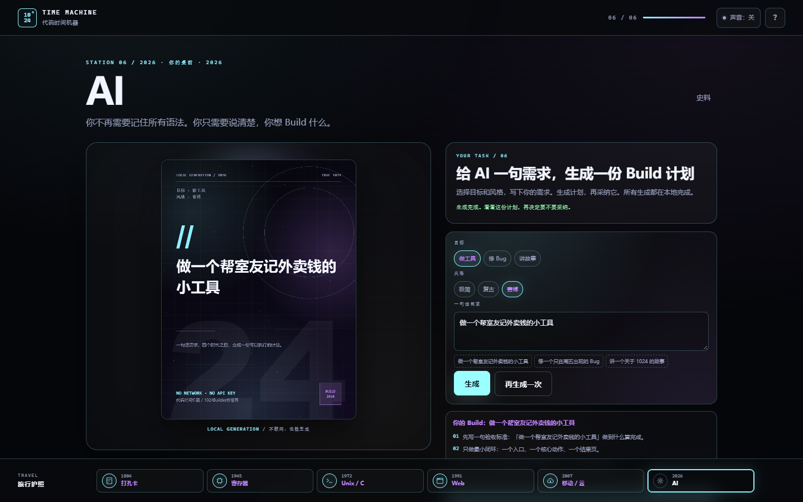
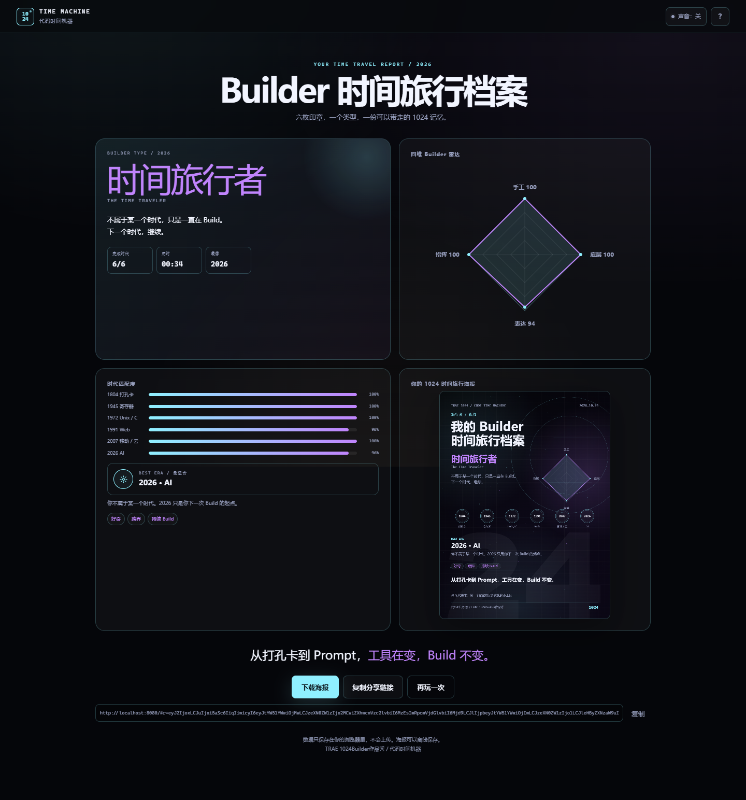
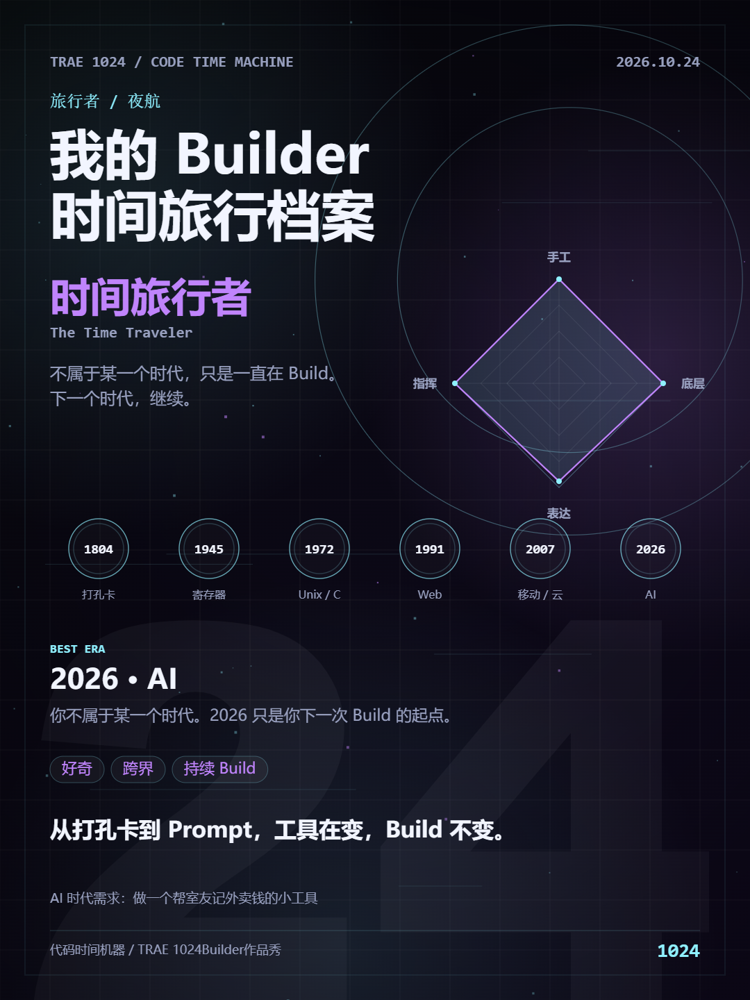
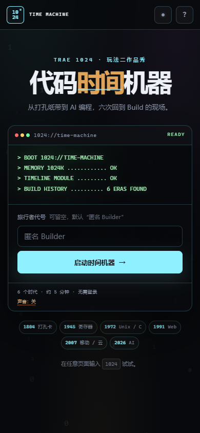

# 代码时间机器 · The Code Time Machine

> 从打孔纸带到 AI 编程，六次回到 Build 的现场。

**Live Demo:** https://reserendipity.github.io/code-time-machine-1024/

TRAE 社区 1024 狂欢周 · 玩法二「TRAE 1024 作品秀」参赛作品。

## 这是什么

一台藏在 1024 号机房的旧终端，带你回到六个编程时代。每一站留下一个印章，最后生成你的 Builder 类型、四维雷达和一张 1080×1440 的海报。

1. **1804 · 打孔卡**：用 5 位二进制打出代号首字母。
2. **1945 · 寄存器**：让 `A + B` 输出 7。
3. **1972 · Unix / C**：用管道从日志里抓出真正的 500 错误。
4. **1991 · Web**：拼出你的第一个个人主页并发布。
5. **2007 · 移动 / 云**：在预算内让 1024 个请求平稳落地。
6. **2026 · AI**：给 AI 一句需求，生成一份 Build 计划。

## 预览






| 可下载海报 | 手机端 |
| --- | --- |
|  |  |

## 怎么玩

- 直接打开在线 Demo，或双击 `docs/index.html` 离线游玩。
- 全程 6 站，每站 30-60 秒，不需要读说明书。
- 所有交互都可以用鼠标或键盘完成，不依赖拖拽。
- 在任意页面输入 `1024`，有一个隐藏频道。
- AI 时代是**本地生成模拟**，不调用真实大模型，不消耗 API Key。

## 本地开发

```bash
# 在仓库根目录
python -m http.server 8080
# 打开 http://localhost:8080
```

## 构建单文件

```bash
node build.js
# 生成 code-time-machine.html
# GitHub Pages 用文件位于 docs/index.html
```

## 技术

- 原生 HTML / CSS / JavaScript，无框架、无构建依赖。
- Canvas 2D：时间隧道、雷达、海报、隐藏结局粒子。
- Web Audio API：合成音效，无音频文件。
- localStorage：刷新继续；URL hash：分享结果。
- 单文件、零外部字体 / 图片 / 音频 / 图标库，可离线运行。
- 支持 `prefers-reduced-motion`，手机 390px 已验证。

## 隐私与 AI 说明

- 不收集、不上传任何数据；昵称和进度只保存在浏览器。
- 海报在本地 Canvas 生成。
- AI 时代使用本地模板生成，是“把一句话拆成计划”的体验模拟，不是真实模型输出。

## 目录

```
index.html            # 开发版入口
styles.css            # 全局样式与六套时代皮肤
js/                   # 状态、音效、六个时代、结果页、主流程
docs/index.html       # GitHub Pages 发布的单文件版
docs/.nojekyll        # 关闭 Jekyll
screenshots/          # 截图与海报
build.js              # 单文件构建脚本
```

## License

Code and original artwork are licensed under the **Apache License 2.0**. See [LICENSE](LICENSE) and [NOTICE](NOTICE).

## 史料参考

- Jacquard loom: https://en.wikipedia.org/wiki/Jacquard_loom
- Herman Hollerith: https://en.wikipedia.org/wiki/Herman_Hollerith
- ENIAC: https://en.wikipedia.org/wiki/ENIAC
- Grace Hopper: https://en.wikipedia.org/wiki/Grace_Hopper
- C language: https://en.wikipedia.org/wiki/C_(programming_language)
- Unix: https://en.wikipedia.org/wiki/Unix
- The Art of Unix Programming: http://www.catb.org/esr/writings/taoup/html/
- World Wide Web: https://home.cern/science/computing/birth-web
- First website: http://info.cern.ch/hypertext/WWW/TheProject.html
- iPhone (1st generation): https://en.wikipedia.org/wiki/IPhone_(1st_generation)
- GitHub Copilot: https://en.wikipedia.org/wiki/GitHub_Copilot
- ChatGPT: https://en.wikipedia.org/wiki/ChatGPT

史料用于交代时代背景，交互为示意性玩法。

---

从打孔卡到 Prompt，工具在变，Build 不变。
